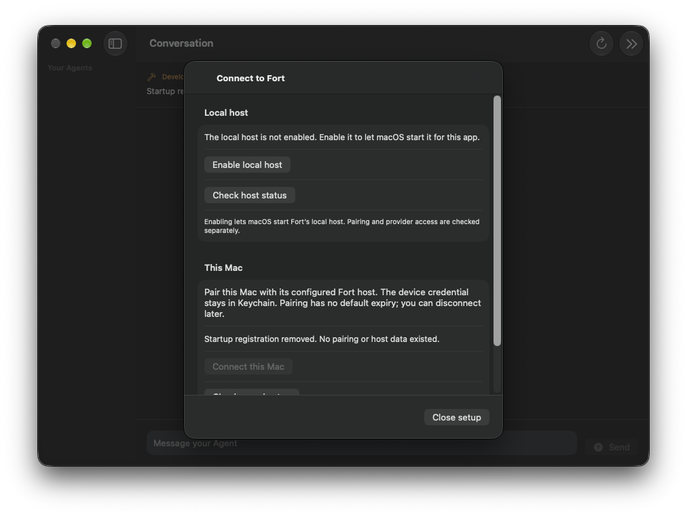

# Approved installed host test, October 19

Spec 059 / decision 059. Base source 092dc52ea62f979f6d5b935371fd0fe95e28c63e.
The owner approved the exact one-time test in Sentinel_5ca1f5e4bb788191b7a2470b8b42a9dd
and selected personal ChatGPT in Sentinel_4d576ff6134481919bb4eaaa71450b8c. The
proposal was Sentinel_1d0357e845108191bda2c580952409d5. No G2 upload approval follows.

The subsequent [self-inspection repair](helper-self-inspection.md) has source and
read-only sandbox evidence. It does not turn this failed live test into a pass.

## Empty MCP repair and authentication handoff

The owner explicitly overrode the initial startup prohibition at 23:52:20 UTC
(Sentinel_cc6a553555a481919adde09325fb740c), responding to the exact test scope in
Sentinel_cd9527eaa9a88191bda2e6a8934b1cca. The previously blocked action was retried
once and admitted. Enable succeeded at 23:53:01; helper startup/XPC, Node/guardian
and this Mac's pairing succeeded. There was no automatic helper restart loop.

One official sign-in attempt ended unconfirmed before presenting a device challenge.
Read-only metadata found no provider credential file. A separate signed diagnostic
with no network entitlement and fresh empty state reproduced Codex's invalid-transport
error for mcp_servers.spritepipe. It never requested account reads, login, discovery
or prompts. The first diagnostic omitted the guardian's required process-group
flag; that probe mistake was corrected before diagnosis. A later diagnostic signal
returned sandbox EPERM after runtime exit; exact process absence was independently
reconciled. The decisive startup failure was the official configuration parser.

The existing controls created three named disabled MCP entries without transports.
Removing those incomplete declarations and explicitly requesting an empty private
MCP map permits startup. Shared attestation still rejects any server not explicitly
disabled; configured inert rows and both global/thread inventory checks are retained.
No transport, connector, entitlement, account fallback or tool permission was added.
The private paths still reject ambient config and protect credential metadata.

The new empty-MCP public runtime test and private-plan assertion both failed first.
After the fix, 561 focused tests passed with five optional benchmark skips. The
initial restricted run had 18 local-IPC fixture failures; normal local IPC access
passed the same suite. Strict TypeScript checking and executor artifact compilation
passed. Fourteen additional legacy-caller/artifact tests passed with one optional
benchmark skip; those fixtures never activated a historical provider packet.
The actual compiled executor passed initialize and effective controls in
the signed no-network diagnostic with no stderr. This proves startup, not a reply.

Before replacing the app, normal Prepare to remove Fort confirmed host shutdown,
revocation, startup unregistration and local credential removal. The AX confirmation
returned -25205 while the UI actually reported success; no action was repeated.
Normal Quit with Settings open failed; Back/Done then normal Quit succeeded. Exact
job/process absence and provider-credential-path absence passed at 23:57:29 UTC.
The retained database and removal receipts were kept. Keychain content was not read;
the app's completed removal path reported scoped device-token removal. This separate
Settings-sheet Quit defect was then repaired in source as recorded below; installed
verification of that later native change is still pending.

The replacement is /tmp/fort059-empty-mcp-signed-20261020/Fort.app, installed at
/Users/tobiasgunn/Applications/Fort.app. It contains 206 files / 406,612,452 bytes
and 30 Mach-O objects. Report SHA256
0ab05d939bcbdc7eb1d0905156790a42a1db4375b5bb1ac63d6106cb95d563fc;
payload SHA256 f8d34ba0dcd15b49ad8146993e03e6bbb72f81c3972e33fc6eaa72230d55323f.
Source base is 6c848f7d3f0a352a20acdde14b57831f93f2c1fb; the report pins the two
changed TypeScript source hashes. Compiled controls/plan/declarations, executor
manifest and signature seals changed; native executable changes are re-signing.
All file membership/hash/mode/size checks, all 30 strict signatures/public leaf
fingerprints, unchanged entitlements, strict nested signature and native bundle
inspection passed. The old installed copy is preserved at
/tmp/fort059-installed-self-inspection-preserved-20261020.app.

Set up Fort again retained prior history. Enable succeeded at 00:03:42 UTC; an
immediate Connect press was refused while the control was disabled, then one later
press when enabled paired successfully. Toolbar menu Accessibility lookup missed
an item that the screenshot showed; exact label/process-checked hit-testing opened
Settings. No authentication action occurred during that navigation.

The repaired app reached the official device challenge, and Open verification page
succeeded at 00:06:29 UTC. The user was immediately asked to complete personal
ChatGPT verification and confirm when finished. The code was not read, recorded or
transmitted. Zero of six model prompts have been sent. At this handoff the exact
host/pairing are active; final cleanup remains pending. Do not claim authentication,
account selection, Astra discovery/replies or TestFlight acceptance. G2 is excluded.
Raw redacted logs, metadata, screenshots before authentication, candidate reports and
the handoff record remain under /tmp/fort059-attended-resume-20261019.

## Settings repair during the authentication handoff

The first device-code attempt reached its operation bound and canceled without
revoking existing account access. At the last redacted status check, 00:09:43 UTC,
Sign in to runtime was enabled again; no challenge was visible. The owner was given
the normal Settings / Pairing and local host sign-in step and asked to confirm
personal ChatGPT authentication. No new code was generated by this source slice,
and no credential or device-code content was inspected.

The [Settings-only Quit repair](installed-setup-quit.md#settings-sheet-repair-october-20)
was developed and built separately while that user step remained pending. It extends
the existing setup-sheet window behavior to Settings; no account, host, storage or
termination-handler logic changes. The installed app was not replaced, navigated,
quit or relaunched. The exact host/pairing remain at their last observed active
handoff state, with cleanup pending and zero of six prompts used. Do not infer
successful authentication from elapsed time or from the source/build results.

## Extended-time continuation

At 23:43:54 UTC the owner said “Extend these as long as needed as a rule going
forward” (Sentinel_15479ff398d081918411da08295352de), in response to extending
this installed test. The original time record is preserved, not reset. Personal
ChatGPT, gpt-6-astra only if reported, six synthetic prompts total, unchanged
permissions and verified cleanup remain the bounded scope. G2 upload is separate.

The self-inspection candidate was verified again: all 206 files/modes/sizes/hashes,
all 30 strict signatures and public signing leaf fingerprints, exact entitlements,
strict nested signature and native full-package inspection passed. Report SHA256
b887864ad524a4cd312130b1f55cc2eb7abfec666a19dcaeb50ad29541fbecae;
payload SHA256 aac1011e317607d5b56a293ffdd237ffbe7ad16b328eb894e1676b015cda024f.
It was installed at /Users/tobiasgunn/Applications/Fort.app. The prior cleanup
app was preserved at /tmp/fort059-installed-cleanup-preserved-20261019.app.
The installed setup UI reported the host not enabled and Connect disabled.

Automatic approval review rejected the exact Enable local host action before
execution. Its reason: persistent startup conflicts with the original import-only
prohibition, and extending time alone is insufficient. Reconsideration after
checking the prior proposal, approval references and same-scope retry record was
also rejected: the review treats those files/assistant claims as untrusted evidence.
The source-thread read returned no turns, so it did not independently recover the
original human approval. This record does not override the rejection. No workaround,
registration, pairing, credential creation or provider authentication occurred.
The owner was asked for an explicit confirmation of the concrete installed test.

Normal client Quit passed. At 23:49:32 UTC, independent launchctl exit 113 and
process/path checks confirmed no exact host job or owned process, no FortHost
storage or provider credential path, and only the zero-byte mode-0600 setup lock
in native storage. Installed files still match all 206 manifest records. No token
was generated; Keychain contents were not read. Zero of six prompts have been used.
No provider authentication handoff has been reached. Full startup/XPC, account/model
controls, replies, cancellation and paired lifecycle remain unrun after the repair.

Continuation authority, exact action/result, redacted AX and final absence records
are under /tmp/fort059-attended-resume-20261019. No product source changed or
behavioral tests reran for this evidence-only checkpoint. Existing native test/build
results in the linked repair and original outcome remain historical proof with their stated limits.

## Outcome

The original candidate was verified against report SHA256
983ccb10307b07256daba171bee084568fc82d0e8c1772d4c3dffec0a7d1e439 before installation.
All 206 file records, all 30 code signatures/public signing leaf fingerprints,
exact entitlements/profiles and native client-side bundle inspection passed.
The earlier installed app was preserved. No original report was rewritten.

Enable succeeded at 19:18:02 UTC through the installed UI. macOS reported enabled
registration for io.mtree.fort.mac.host. One Connect action then failed: launchd
repeatedly attempted the helper, which exited with code 1 before creating FortHost
storage. The client timed out without pairing. No second Connect action occurred.
The client quit normally; scoped launchctl bootout stopped the exact failed job.
Fort still reported enabled registration afterward. A loaded-job absence check alone
would therefore have been insufficient cleanup evidence.

The first attempt and its cleanup ended at 19:29:26 UTC, before the 19:43:02 cleanup reserve and
19:48:02 deadline. Zero provider sign-ins, zero model requests, zero completed
pairings. The no-default-expiry pairing policy did not change. Personal ChatGPT,
Astra discovery, effective provider controls, replies, cancellation, Stop/Resume
and conversation replay remain untested. The coordinator subsequently confirmed that same-scope retries are allowed within
the original window. A changed hash alone does not require another approval. At
19:41:18 only 104 seconds remained before the cleanup reserve, so the repaired
candidate stayed inactive. No deadline or request allowance was reset.

## Cleanup repair and installed proof

The prior UI exposed removal only after pairing. The repaired client offers Remove
unused startup registration when fresh setup has no pairing. The controller holds
the existing setup lock, checks all eight setup/pairing/removal record kinds are
absent, revalidates exact signed bundle identity, proves the exact App Group's
FortHost child is absent, calls SMAppService.unregister, and rechecks absence.
Existing host storage, any saved record, changed identity, failed unregistration
or uncertain storage prevents success. No file, history or credential is deleted.
Existing paired installations continue through durable host removal.

The cleanup-only candidate is /tmp/fort059-unpaired-cleanup-signed-20261019/Fort.app.
Its report SHA256 is
9e401469e60006e14f063718be077c4aed14f0719c13e3b7d145a2c68b215453;
payload manifest SHA256 is
39375f91f994c8f68accb6d05af5d47c3b07f458e772964768c254640ea10340.
Only Contents/MacOS/FortMac differs from the original signed payload. Helper,
Node, guardian, Codex, profiles, resources and entitlements are unchanged. It was
installed only for the authorized cleanup, never connected or used for sign-in.
The original installed candidate remains preserved at
/tmp/fort059-installed-approved-failed-preserved-20261019.app.

The normal removal confirmation completed. Its AX press returned -25205 while the
app actually completed removal; state was inspected before any retry. Fort reported
notRegistered and disabled Connect. Normal Quit/reopen retained notRegistered.
The final client quit normally. All 206 installed file records still match.
Independent launchctl exit 113, exact process-path checks and metadata confirm
job/process absence, no FortHost directory/provider credential path, and only the
zero-byte owner-setup.lock in native storage. No setup offer or token was generated.
Keychain contents were not read. App/Group containers created by macOS are retained.

## Validation and limits

The new controller behavior test first failed with unavailable, then passed.
The configured focused suite passed 83 test functions, zero failures, six optional
timing skips. It covers fresh cleanup, eight saved-state refusals, existing host
storage, changed signatures/identity, ignored unregistration and storage absence
with files/directories/symlinks. The initial restricted run had three local IPC
fixture errors in two existing functions; normal local IPC permission and explicit
fixture paths passed. Release FortMac built in 31.118 seconds, a single build
sample, not a benchmark. Signed cleanup artifact verification passed. Broader
portable tests, iOS/older-macOS execution and paired installed removal are unrun.

Read-only signed diagnostic copies, with outgoing-network entitlements removed,
reproduce helper bundle inspection failure without service/runtime/provider launch.
A canonical-path probe shows sandbox EPERM when the helper opens its enclosing
client manifest, launch-agent plist and profile; its own corresponding files open.
The helper's current inspection assumes it can read the enclosing app. This remains
an open startup defect here; a later change must preserve exact signed identity
checks without broadening filesystem entitlements. No successful host/provider
or TestFlight acceptance is claimed. G2 upload remains held separately.

Raw redacted controls, source probes, build/test logs, original clock/outcome and
final absence metadata are retained under /tmp/fort059-attended-20261019. Probe
apps are stopped under .local/fort059-readonly-inspection-20261019. They have no
startup registrations and cannot be treated as tested application builds.
